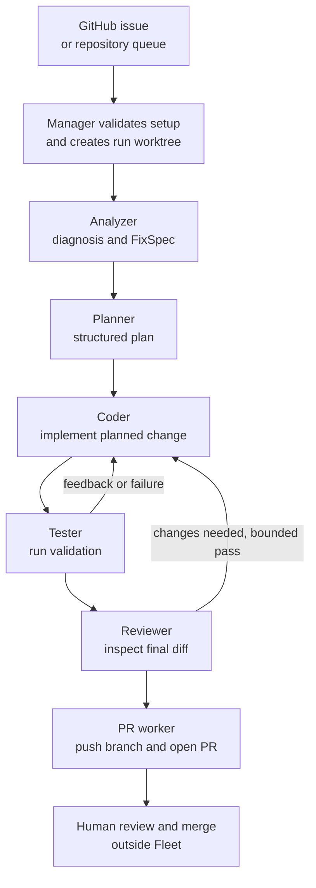

# Fleet

**An autonomous GitHub issue-to-pull-request engineering manager.**

Fleet is a TypeScript application that coordinates six specialized worker roles to take a GitHub issue from investigation to a proposed code change. The Manager controls the workflow; model calls run inside worker processes through OpenAI SDK-compatible provider APIs. You can use **Gemini, OpenRouter, or Ollama** — any one of them is enough. Fleet can run one issue on demand or operate a dashboard-driven queue for a repository.

Fleet analyzes the issue, plans a change, edits code in an isolated Git worktree, validates the change, reviews the diff, and attempts to publish a branch and open a pull request. It also provides a local live dashboard, a terminal UI, PostgreSQL-backed run state, usage tracking, and a signed, tamper-evident System of Record (SOR) event chain.

> **Important:** Fleet can push a branch and open a pull request automatically. It does **not** merge pull requests. A PR is a proposed change, not a guarantee of correctness; keep code review, required checks, and branch protection enabled in GitHub.

## What Fleet provides

- **Six role-specific workers:** Analyzer, Planner, Coder, Tester, Reviewer, and PR.
- **Manager-controlled workflow:** deterministic TypeScript decides the phase order and handles run lifecycle, checkpoints, worktrees, quotas, and finalization. The Manager itself is not an LLM.
- **Issue-to-PR execution:** structured diagnosis, implementation plan, code changes, validation, review, and a PR attempt.
- **Isolated change area:** changes are made in the run's Git worktree under `.runs/`, not in your checked-out working tree.
- **Bounded repair behavior:** implementation and reviewer-feedback fixes are limited; Fleet does not retry indefinitely.
- **Provider choice:** Gemini, OpenRouter, or Ollama, with per-role model configuration and an ordered provider fallback list.
- **Gemini quota coordination (Gemini only):** per-model RPM/TPM/RPD accounting, model switching on quota blocks, and a pause/resume path when daily quota is exhausted.
- **Live observability:** local web dashboard (server-sent events), an ANSI terminal dashboard, worker output, errors, usage/cost information, and quota notices.
- **Persistent run records:** PostgreSQL run state, agent-call and usage records, and checkpoints; per-run traces and session logs under `.runs/`.
- **Audit utilities:** SOR chain verification and repair commands, plus usage analytics and summary reporting.
- **Role-gated GitHub access:** workers reach GitHub through a Fleet-owned MCP server backed by the `gh` CLI, with a per-role tool allowlist (`src/mcp/`).
- **Queue and webhook entry points:** a single-issue CLI path, a dashboard-driven queue for eligible open issues, and an optional webhook trigger.

## How a run works



The route is owned by `src/router.ts` and the orchestrator, not freely chosen by an LLM:

1. **Analyzer** reads the issue, gathers context, and produces a structured diagnosis (`FixSpec`).
2. **Planner** turns the diagnosis into an approach, ordered steps, files to change, tests, and acceptance criteria.
3. **Coder and Tester** implement and validate in a bounded loop. Tester validation is based on command outcomes, not just a worker's claim that tests passed. Issues carrying the exact `documentation` label skip the dedicated Tester role.
4. **Reviewer** evaluates the final diff and reports blocking and non-blocking concerns. A limited reviewer-feedback auto-fix round is configured.
5. **PR worker** pushes the fix branch and attempts to open a PR linked to the issue. If the worker cannot report the PR URL, Fleet has a fallback path to look up or create the PR. If no PR can be recovered, the run is marked failed.

Fleet can fail at any stage, for example if provider configuration is invalid, a required command fails, Git operations fail, or GitHub cannot accept the PR. A successful worker response is not proof that a run completed end to end.

## Architecture at a glance

| Area | Responsibilities | Source |
|---|---|---|
| Manager and orchestration | CLI modes, run lifecycle, routing, worktree setup, checkpoints, finalization, pause/resume | `src/index.ts`, `src/orchestrator.ts`, `src/router.ts` |
| Worker agents | Role instructions and role-specific tasks | `src/fleet/agents/` |
| Worker runtime and tools | Model/tool loop, streamed events, tool execution, usage and error reporting | `src/runtime/worker/`, `src/fleet/loop.ts`, `src/fleet/tools/` |
| Providers and model policy | Gemini, OpenRouter, Ollama clients; per-role model resolution and fallback | `src/providers/registry.ts`, `src/models/`, `src/gemini/` |
| Git and GitHub | Issue lookup, cloning, worktrees, branch operations, PR creation | `src/git/`, `src/github/`, `src/mcp/` |
| Persistence and audit | PostgreSQL state/checkpoints, agent-call records, SOR event chain and verification | `src/db/`, `migrations/`, `src/sor/` |
| Dashboard and TUI | Live run state, worker output, provider/model controls, quota notices, stop/resume | `src/dashboard/`, `src/tui/` |
| Daemon | Queue scanning, issue de-duplication, webhook intake | `src/daemon/` |
| Workforce policy | Worker lifecycle/authorization and concurrency policy | `src/workforce/` |
| Manager artifacts | Model overrides, memory and session files | `manager/` |

Workers receive role-specific toolsets, including repository read/edit tools and a shell tool. The tool layer restricts file operations to the run worktree, but that path restriction is **not** an operating-system sandbox.

## Requirements

- **Node.js 22 or newer** and npm
- **PostgreSQL 16** reachable by Fleet. The optional Content SoR features use the `pgvector` extension; if it is unavailable, migration 015 skips those tables instead of failing.
- Git
- GitHub CLI (`gh`), installed and authenticated for live issue/PR operations
- **At least one model provider:** a Gemini API key, an OpenRouter API key, or a reachable Ollama endpoint

## Quick start

### 1. Install

```bash
git clone https://github.com/Saif-Ali-109/Fleet.git
cd Fleet
npm install
cp .env.example .env
```

### 2. Configure `.env`

Every setup needs:

- `DATABASE_URL` — your PostgreSQL connection string
- `SOR_SIGNING_KEY` — a 32-byte hex key for the SOR audit chain (generate one with `openssl rand -hex 32`). Key rotation via `SOR_KEY_ID` / `SOR_KEY_<ID>` is described in `.env.example`.
- **One provider**, from the table below

| Provider | Minimum configuration | Notes |
|---|---|---|
| Gemini | `GEMINI_API_KEY`, plus the six `<ROLE>_MODEL_GEMINI` variables and matching `GEMINI_QUOTA_LIMITS` / `GEMINI_RATE_LIMIT_MODELS` | Quota and model-chain settings are validated before a real run starts. |
| OpenRouter | `OPENROUTER_API_KEY` | Optionally set `<ROLE>_MODEL_OPENROUTER` per role. Models must support tool calling. |
| Ollama | `OLLAMA_BASE_URL` (default `http://localhost:11434/v1`), no API key | Set `<ROLE>_MODEL_OLLAMA` to models you have pulled locally. Use `FLEET_LLM_STREAM=1` for slow CPU-only setups. |

Then **select the provider explicitly**, because the built-in default is Gemini when nothing is set:

```bash
# in .env
ORCHESTRATOR_PROVIDER=openrouter   # or gemini | ollama

# or per run
npm start -- --repo owner/repo --issue 123 --provider ollama
```

`FLEET_PROVIDERS` sets the comma-separated fallback order (code default: `gemini,openrouter,ollama`). Providers without credentials are skipped during fallback, so you only need to configure the ones you use. Gemini quota/model-chain validation runs only when Gemini is the selected provider.

The checked-in `.env.example` is a template with every option listed, not a drop-in configuration. Some comments in it describe the Gemini setup; trim or ignore what you do not use.

GitHub authentication comes from the local `gh` CLI, not a Fleet-specific token variable:

```bash
gh auth login
gh auth status
```

### 3. Prepare the database

Create a PostgreSQL database, set `DATABASE_URL`, and apply the schema:

```bash
npm run migrate:up
```

### 4. Run a no-token dry run

```bash
npm run dry -- --repo owner/repo --issue 123
```

A dry run uses a stub issue and skips cloning, worker execution, `gh` calls, and Gemini quota validation. It is a wiring smoke test, not a check of model quality or GitHub permissions. Always pass `--repo` and `--issue`: without them, Fleet starts queue mode (in dry-run) instead.

### 5. Run one real issue

```bash
npm start -- --repo owner/repo --issue 123
```

Use a repository and issue the authenticated GitHub account can access. The dashboard normally starts at `http://127.0.0.1:3456/`; use `--no-web` to disable it or `--port <n>` to change the port.

## Operating modes

### Single issue

```bash
npm start -- --repo owner/repo --issue 123
npm start -- --repo owner/repo --issue 123 --provider openrouter
npm start -- --repo owner/repo --issue 123 --branch fix-my-issue --no-web
npm run dry -- --repo owner/repo --issue 123
```

| Option | Purpose |
|---|---|
| `--repo <url>` | Repository to work on (URL or `owner/name`) |
| `--issue <n>` | Issue number to process |
| `--dry-run` | Stubbed dry-run mode |
| `--branch <name>` | Explicit fix-branch name; otherwise Fleet generates one |
| `--port <n>` | Dashboard port (default `3456`) |
| `--no-web` | Disable the dashboard (requires `--repo`) |
| `--provider <name>` | `gemini`, `openrouter`, or `ollama` (overrides `ORCHESTRATOR_PROVIDER`) |
| `--help` | Print CLI usage |

### Dashboard-driven repository queue

```bash
npm start
```

With no `--repo`/`--issue`, Fleet starts queue mode. Enter a repository URL in the dashboard and Fleet scans and processes eligible open issues one at a time, rescanning every `SCAN_INTERVAL_MINUTES` (default `5`). Fleet uses issue labels and stored run state to avoid duplicate work.

**Use queue mode deliberately.** It can process multiple issues and create multiple PRs without asking for approval before each one. Start with a dedicated test repository and configure GitHub branch protection and required checks before pointing it at important code.

An optional webhook trigger is enabled by setting `WEBHOOK_SECRET`; when unset, the webhook endpoint is disabled. Review `src/daemon/webhook.ts` and `.env.example` before exposing or proxying webhook traffic.

## Providers and model selection

All three providers are used through the OpenAI SDK-compatible client interface.

| Provider | Credential | Notes |
|---|---|---|
| Gemini | `GEMINI_API_KEY` | Explicit per-model RPM/TPM/RPD accounting and a configurable model fallback pool. |
| OpenRouter | `OPENROUTER_API_KEY` | Optional `HTTP_REFERER` and `X_TITLE` ranking headers. |
| Ollama | none (`OLLAMA_BASE_URL`) | Local endpoint. The chosen model must already be available there. |

The primary provider is chosen with `--provider` or `ORCHESTRATOR_PROVIDER`. Availability of a fallback provider does not guarantee equivalent tool-calling behavior, context size, or output quality — test the provider and models you plan to rely on.

Models are configured per role with `<ROLE>_MODEL_<PROVIDER>` variables, for example `ANALYZER_MODEL_GEMINI` or `CODER_MODEL_OPENROUTER`. Roles are `ANALYZER`, `PLANNER`, `CODER`, `TESTER`, `REVIEWER`, and `PR`. Resolution order: dashboard override, environment variable, provider/role tier default, then baseline policy. Dashboard overrides are saved in `manager/models.json`.

### Gemini-only settings

These apply only when Gemini is the selected provider:

- `GEMINI_RATE_LIMIT_MODELS` — ordered fallback pool used when a model is rate-limited.
- `GEMINI_QUOTA_LIMITS` (or `GEMINI_QUOTA_OVERRIDES`) — per-model `rpm`, `tpm`, and `rpd` limits. Every model in use needs positive-integer values, and unknown models fail validation instead of running with guessed limits.
- `GEMINI_RATE_LIMIT_WAIT_MS` — cap on the wait for a rolling limit (default `120000`).
- When all configured Gemini models exhaust their daily allowance, the run can pause. After you update the key, use the dashboard **Resume** action: Fleet re-reads `GEMINI_API_KEY` and `OPENROUTER_API_KEY` from `.env` and continues from the relevant checkpoint.

Use `.env.example` as the reference for the full configuration surface.

## State, traces, and audit

- PostgreSQL stores run status, phase/checkpoint information, agent-call records, and usage.
- Run-local worktrees, traces, and session logs live under `.runs/<run-id>/`. Do not hand-edit them.
- The SOR is a signed hash chain intended to make changes to recorded events detectable. Verify it with `npm run sor:verify`.
- SOR writes are non-fatal: a failed audit write logs a warning without stopping the run. A valid hash chain therefore does not prove that every expected event was recorded.
- `npm run sor:repair` re-signs audit rows under the current key. Treat it as a privileged signing-key recovery operation, not routine maintenance.

## Commands

| Command | Purpose |
|---|---|
| `npm start -- --repo <repo> --issue <n>` | Process one issue |
| `npm start` | Launch the dashboard-driven repository queue |
| `npm run dry -- --repo <repo> --issue <n>` | Stubbed dry run (equivalent to `--dry-run`) |
| `npm run build` | Compile TypeScript with `tsc` |
| `npm run typecheck` | Type-check without emitting output |
| `npm test` | Run the Vitest suite once |
| `npm run test:coverage` | Run tests with coverage |
| `npm run test:watch` | Run tests in watch mode |
| `npm run lint` | Run Biome checks |
| `npm run format` | Format with Biome |
| `npm run migrate:up` / `npm run migrate:down` | Apply/revert database migrations |
| `npm run sor:verify` | Verify SOR chain integrity |
| `npm run sor:repair` | Re-sign SOR audit rows for key recovery |
| `npm run analytics` | Generate cost/usage analytics report |
| `npm run generate-memory` | Generate the summary/analytics report |
| `npm run sor:content:sync` | Run the SOR content synchronization CLI |
| `npm run sor:context` | Run the SOR context CLI |
| `npm run sor:at` | Run SOR acceptance tests (dedicated Vitest config) |

## Validate before a live run

For development changes, the recommended baseline (the same checks CI runs, plus a dry run) is:

```bash
npm run dry -- --repo owner/repo --issue 123
npm run lint
npm run typecheck
npm test
```

For a live smoke test, use a disposable repository and check that:

- the issue was analyzed and the intended file was changed;
- the expected test command actually executed and succeeded;
- the final diff matches the acceptance criteria with no unrelated changes;
- a branch was pushed and a PR was created with the correct issue reference;
- the PR's CI checks pass and a reviewer can understand the change;
- run records and provider usage are complete enough for debugging.

A passing unit test or a PR description reporting success is not proof of end-to-end success. Prefer the actual CI result and diff.

## Example history in `demo-repo`

The public [`Saif-Ali-109/demo-repo`](https://github.com/Saif-Ali-109/demo-repo) repository contains issue-linked PRs and issues that show both successful and failed runs:

| Record | Observed result |
|---|---|
| [PR #2 — Fix #1: incorrect output for multiples of 15](https://github.com/Saif-Ali-109/demo-repo/pull/2) | Merged |
| [PR #4 — Fix #3: add `--list` mode](https://github.com/Saif-Ali-109/demo-repo/pull/4) | Merged |
| [PR #6 — Fix #5: add `--range N M` mode](https://github.com/Saif-Ali-109/demo-repo/pull/6) | Closed without merge |
| [PR #8 — Fix #7: add `--csv` output mode](https://github.com/Saif-Ali-109/demo-repo/pull/8) | Merged |
| [PR #11 — Fix #10: validate non-positive input](https://github.com/Saif-Ali-109/demo-repo/pull/11) | Merged |
| [Issue #15 — Add README with project description](https://github.com/Saif-Ali-109/demo-repo/issues/15) | Closed. Run comments show many repeated attempts, a CLI flag error from a provider backend, and a later `git commit` failure after the README already existed. These runs predate the current worker design. |

These records show that the workflow has completed real issue-to-PR tasks and also exposes failure cases. They are **examples, not a controlled benchmark**: they do not establish a success rate, production readiness, or cost per successful task.

## Security and operational boundaries

Fleet can execute shell commands, modify repository files, push branches, and open PRs with the local environment's permissions. Treat it as a powerful automation process.

- **Least privilege:** authenticate `gh` with an account or token scoped to the intended repositories. Avoid broad organization or admin permissions.
- **Require GitHub protections:** configure required CI checks, review requirements, and branch protection outside Fleet. Fleet does not merge PRs, but it can open them automatically.
- **Untrusted input:** issue bodies, comments, documentation, and source files can contain malicious or misleading instructions. Review agent changes before merging.
- **Sandboxing:** the worktree and role tool restrictions reduce accidental file access but do not replace OS/container isolation. For untrusted repositories, use an ephemeral runner, restrict network access, avoid mounting secrets, and discard the environment after the run.
- **Secrets:** keep `.env` out of version control, and never put credentials in issue text, prompts, source files, or logs. Check worker output and traces before sharing them.
- **Dashboard:** it binds to `127.0.0.1` by default. Do not expose it publicly without authentication and network controls.
- **Audit limitations:** SOR events are tamper-evident, but write failures are non-fatal. Monitor audit warnings and verify the chain regularly.
- **Hosted providers:** code, issue text, and repository context are sent to whichever provider you select (Gemini or OpenRouter). Use Ollama if that is not acceptable.
- **Queue mode:** test on a disposable repository first; it can act on several issues and open multiple PRs.

## Troubleshooting

**GitHub operations fail or wait for authentication**

```bash
gh auth status
gh auth login
```

**No provider is available**

Check `--provider` / `ORCHESTRATOR_PROVIDER`, `FLEET_PROVIDERS`, and the credential for each provider you intend to use. Ollama must be running at `OLLAMA_BASE_URL` and the requested model must be pulled there.

**Fleet complains about Gemini quota or model configuration, but I am not using Gemini**

Gemini validation runs when the selected provider is Gemini, which is the default if nothing is set. Set `ORCHESTRATOR_PROVIDER` or pass `--provider`.

**Gemini quota/model validation fails before a run starts**

Make sure all six `<ROLE>_MODEL_GEMINI` variables are set and every model in the fallback pool has positive integer `rpm`, `tpm`, and `rpd` entries in `GEMINI_QUOTA_LIMITS`. Update the model chain and quota map together.

**PostgreSQL connection or migration errors**

Verify `DATABASE_URL`, confirm PostgreSQL is reachable, then run `npm run migrate:up`.

**The run created a branch but no PR URL was reported**

Inspect the run log and your GitHub branches/PRs. Fleet has fallback lookup/create logic, but the run can still fail if the push or PR creation fails.

**The local dashboard is unavailable**

It defaults to `127.0.0.1:3456`. If the port is in use, pass `--port <n>`, or run with `--no-web` (single-issue mode only).

## Development

```bash
npm install
npm run dry -- --repo owner/repo --issue 123
npm run lint
npm run typecheck
npm test
```

CI runs lint, typecheck, migrations, and `npm run test:coverage` on Node 22 with PostgreSQL 16. Provider APIs should be mocked in automated tests so unit tests never consume real provider quota.

Useful references:

- [`AGENTS.md`](AGENTS.md) — repository rules and safety boundaries for coding agents
- [`SPEC.md`](specs/core/SPEC.md) — detailed behavior and implementation specification
- [`CONTRIBUTING.md`](CONTRIBUTING.md) — development setup and contribution workflow
- [`specs/`](specs/) — plans, design proposals, security notes, and system-of-record specs
- [`.env.example`](.env.example) — provider, model, quota, database, dashboard, and audit settings
- [`demo-repo`](https://github.com/Saif-Ali-109/demo-repo) — example issue-to-PR history, including failures
